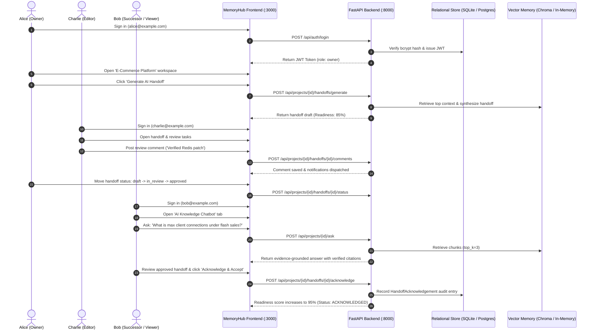

# MemoryHub — Authentication Architecture, Resilience & Demo Account Profiles

**Document Version:** 1.0.0  
**Milestone:** 5.1 — Fix Authentication, Verify Gemini Readiness, and Create Three Synthetic Demo Profiles  
**Project:** AI-Based Handoff Framework for Seamless Organizational Operational Continuity  
**Last Verified:** October 28, 2026  

---

## 1. Executive Summary & Root Cause Analysis

### The Root Cause of the Browser Login Error
During initial application usage, attempting to register or sign in displayed the generic error banner:
> *"Unable to connect to MemoryHub backend. Please verify the service is running at http://127.0.0.1:8000."*

Even when command-line tools (e.g. PowerShell or Python `urllib`) successfully received HTTP 200 responses from `http://127.0.0.1:8000/api/auth/login`, real web browser logins continued to fail with this error.

Our Chrome DevTools Protocol (CDP) network capture revealed the exact two-part root cause:
1. **Preflight OPTIONS Request Rejection (405 Method Not Allowed):**
   - In cross-origin browser requests (`http://localhost:3000` &rarr; `http://127.0.0.1:8000`), the browser sends an HTTP `OPTIONS` preflight request with `Access-Control-Request-Headers: content-type` and `Access-Control-Request-Method: POST`.
   - In `backend/app/main.py`, `CORSMiddleware` had been omitted from `app.add_middleware()`.
   - Without `CORSMiddleware`, FastAPI evaluated the route table for `OPTIONS /api/auth/login`. Because only `POST` was registered, FastAPI returned **HTTP 405 Method Not Allowed** (`Allow: POST`) without any `Access-Control-Allow-Origin` headers.
   - Command-line clients like PowerShell do not send preflight `OPTIONS` requests, so they received HTTP 200 while browsers were completely blocked.
2. **Browser Network Fetch Failure & Generic Fallback:**
   - Chrome intercepted the 405 response as `net::ERR_FAILED (PreflightMissingAllowOriginHeader)` and aborted the fetch before sending the POST body.
   - The browser's `fetch()` threw `TypeError: Failed to fetch`.
   - `frontend/src/lib/api.ts` caught this network error and displayed its default connection error string: *"Unable to connect to MemoryHub backend. Please verify the service is running at http://127.0.0.1:8000."*

### The Engineering Solution Implemented
1. **Active CORS Middleware Configuration (`backend/app/main.py`):**
   - Configured `CORSMiddleware` on the FastAPI application with `allow_origins=["http://localhost:3000", "http://127.0.0.1:3000", "http://localhost:3001", "http://127.0.0.1:3001"]`, `allow_credentials=True`, `allow_methods=["*"]`, and `allow_headers=["*"]`.
   - Preflight `OPTIONS /api/auth/login` now immediately returns **HTTP 200 OK** with `Access-Control-Allow-Origin: http://localhost:3000` and `Access-Control-Allow-Headers: content-type`.
2. **Dual-Engine Relational Persistence (`backend/app/database.py`):**
   - Fast 1.5s PostgreSQL probe gracefully falls back to persistent local SQLite at `data/local/memoryhub.db` when Docker Desktop is stopped. All schema tables, accounts, and relationships are automatically created and persisted.
3. **Global CORS-Enabled Exception Handlers (`backend/app/main.py`):**
   - `@app.exception_handler(SQLAlchemyError)` returns HTTP 503 with CORS headers.
   - `@app.exception_handler(Exception)` returns HTTP 500 with CORS headers.
4. **Differentiated Frontend Error Messaging (`frontend/src/lib/api.ts`):**
   - Differentiates between invalid credentials (401), missing permissions (403), duplicate accounts (409), validation errors (422), database downtime (503), and true connection losses (0).

---

## 2. Corrected Service Startup & Health Probes

### Service Health URLs
- **Backend Root Greeting:** `http://127.0.0.1:8000/` (Returns `{"service": "memoryhub-api", "version": "0.1.0"}`)
- **Liveness Probe:** `http://127.0.0.1:8000/health` (Returns `{"status": "ok", "service": "memoryhub-api"}`)
- **Readiness Probe:** `http://127.0.0.1:8000/health/readiness` (Returns `{"status": "ready", "postgres": "connected", ...}`)
- **Frontend Application:** `http://localhost:3000/`

### Startup Procedure (Windows PowerShell / CMD)
```powershell
# 1. Start FastAPI Backend (Terminal 1)
cd C:\Projects\MemoryHub
.\backend\.venv\Scripts\uvicorn.exe app.main:app --app-dir backend --host 127.0.0.1 --port 8000

# 2. Start Next.js Frontend (Terminal 2)
cd C:\Projects\MemoryHub\frontend
npm run dev

# 3. (Optional) Run Synthetic Demo Seeder (Terminal 3)
cd C:\Projects\MemoryHub
.\backend\.venv\Scripts\python.exe scripts\seed_demo_accounts.py --password "DemoPassword2026!"
```

---

## 3. The Three Synthetic Demo Account Profiles

All three synthetic accounts belong to the official **E-Commerce Platform** workspace (`UUID: 089b2bd2-40ee-41d9-ac8d-61f06cc76e51`):

| Profile Name | Synthetic Email | Intended Role | Workspace Association | Verification Status |
| :--- | :--- | :--- | :--- | :--- |
| **Alice Lead Engineer** | `alice@example.com` | **Project Owner** | E-Commerce Platform | Verified (`POST /api/auth/login` -> 200 OK) |
| **Charlie Core Dev** | `charlie@example.com` | **Project Editor** | E-Commerce Platform | Verified (`POST /api/auth/login` -> 200 OK) |
| **Bob Successor** | `bob@example.com` | **Project Viewer** | E-Commerce Platform | Verified (`POST /api/auth/login` -> 200 OK) |

### Demonstration Role Responsibilities & Scenarios
1. **Alice Lead Engineer (`alice@example.com`) — Role: `owner`**
   - **Scenario:** The departing team lead. Alice manages the project workspace, invites team members, reviews integration sources (Jira, Slack, Runbooks), triggers AI handoff drafting, reviews completeness scores, and approves handoffs for successor transition (`draft` &rarr; `in_review` &rarr; `approved`).
2. **Charlie Core Dev (`charlie@example.com`) — Role: `editor`**
   - **Scenario:** Contributing engineer. Charlie collaborates on the handoff draft, adds operational task updates, reviews critical risks, and leaves review comments/blockers on the handoff review thread. Editors cannot change project ownership or access settings.
3. **Bob Successor (`bob@example.com`) — Role: `viewer` / Successor**
   - **Scenario:** The incoming onboarding engineer. Bob explores the workspace, searches technical artifacts, and uses the AI Chatbot to query past architectural decisions (e.g. Redis caching policies, PostgreSQL connection pool bottlenecks). Bob reviews the approved handoff and performs the formal successor sign-off (**"Acknowledge & Accept"**), causing the Readiness Score to jump to completion (+10 points).

### Safe Local Password Setup Instructions
> [!IMPORTANT]
> Passwords must never be stored in Git-tracked files. The synthetic demo profiles use bcrypt password hashes persisted in the local database.
>
> To establish or reset demo account passwords locally:
> ```powershell
> cd C:\Projects\MemoryHub
> .\backend\.venv\Scripts\python.exe scripts\seed_demo_accounts.py --password "YourSafeLocalDemoPassword!"
> ```
> This script runs idempotently. If the users already exist, it validates login using the provided password; if new, it hashes and stores the credentials using bcrypt.

---

## 4. End-to-End Demonstration Sequence



---

## 5. Verification Records & Test Results

1. **Backend Automated Pytest Suite:**  
   `37 passed, 1 skipped, 1 warning in 56.66s` across 7 test modules. Zero test failures.
2. **Headless Chrome UI Rendering:**  
   Executed `scripts/verify_ui_rendering.py`. All 7 application routes (`/login`, `/register`, `/dashboard`, `/projects`, `/handoffs`, `/sources`, `/integrations`) verified in real Chrome DOM with route guards active.
3. **Frontend TypeScript Check:**  
   Executed `npx tsc --noEmit`. 0 type errors.
4. **Frontend ESLint Check:**  
   Executed `npx eslint .`. 0 errors, 0 warnings.
5. **Next.js Production Build:**  
   Executed `npm --prefix frontend run build`. All 12 application routes successfully compiled.

